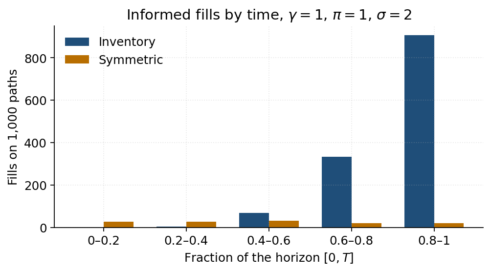
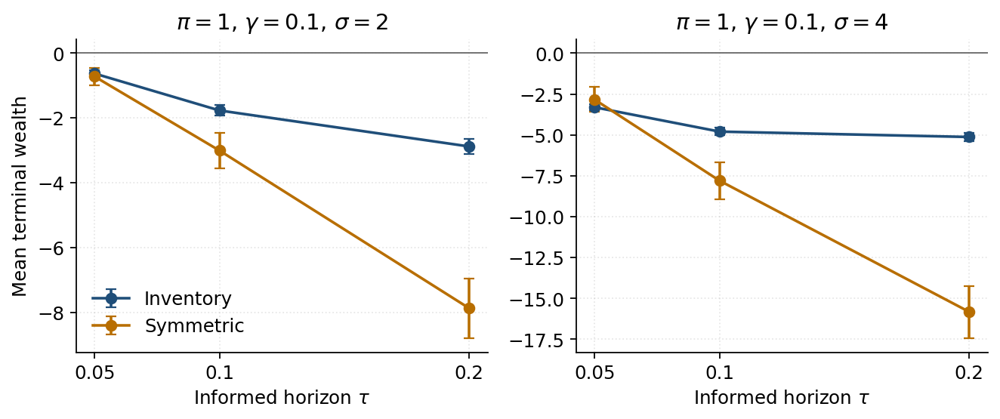

# Avellaneda-Stoikov market making with adverse selection

A discrete-time simulation of Avellaneda and Stoikov (2008), and a controlled comparison with a market maker who posts the same average spread but does not skew quotes for inventory. The extension, which the paper does not treat, is a fraction of informed clients who trade only when the quote is on the wrong side of a future mid.

NumPy only. The mid is an arithmetic random walk. Execution probabilities are Bernoulli. One thousand paths, fixed seeds.

At $\gamma = 0.1$ with no informed flow, inventory control costs $3.3 \pm 0.7$ of mean profit and cuts P&L volatility by about half. With informed clients that profit gap is gone at $\pi = 0.5$, and the inventory loss is the smaller one at $\pi = 1$ when $\tau \ge 0.1$. At $\gamma = 1$ and $\pi = 1$, the spread that tightens into the close is where informed flow hits. The baseline, posted at a constant wide spread, barely trades.

## Quotes

The mid has no drift. Over a step of length $dt$ it moves by $\pm \sigma \sqrt{dt}$.

A unit inventory $q > 0$ pulls the reservation price below the mid:

$$
r = s - q \, \gamma \, \sigma^2 (T - t).
$$

Bid and ask are centered on $r$, not on $s$. The half-spread on each side is half of

$$
\delta_a + \delta_b = \gamma \, \sigma^2 (T - t) + \frac{2}{\gamma} \ln\left(1 + \frac{\gamma}{k}\right).
$$

The first term is the compensation for inventory risk over the time left. It is zero at $T$. The second is the markup that trades a larger edge per fill against a lower arrival rate $\lambda(\delta) = A e^{-k\delta}$. It does not vanish at expiry. In this approximation the spread does not depend on $q$. Only the center does.

Fills use the distance to the mid. A long inventory moves both quotes down, so the ask is closer to the mid than the bid and is hit more often. That is the inventory control. The symmetric benchmark posts the inventory strategy's average spread, constant through time, and centers it on the mid. Same width, no skew.

Each side fills with probability $\min(\lambda(\delta)\, dt, 1)$, from an independent draw. Both sides can fill in one step. A bid fill buys one share. An ask fill sells one share. Terminal wealth is cash plus leftover inventory marked at the final mid.

Parameters of the paper: $s_0 = 100$, $T = 1$, $\sigma = 2$, $dt = 0.005$, $k = 1.5$, $A = 140$, $q_0 = 0$, 1,000 paths.

## Match to the paper

Seeds 0 for the paths and 1 for the fills. No informed flow. Profit is the mean terminal wealth. The $\pm$ is the 95% half-width, $1.96$ standard errors.

| $\gamma$ | Strategy | Spread | Profit | Std(profit) | Std($q_T$) | Paper: profit, std, std($q_T$) |
|---:|---|---:|---:|---:|---:|---|
| 0.01 | Inventory | 1.35 | 68.5 ± 0.6 | 9.1 | 5.4 | 68.6, 8.7, 5.1 |
| 0.01 | Symmetric | 1.35 | 68.4 ± 0.9 | 13.8 | 9.0 | 68.8, 12.8, 8.7 |
| 0.1 | Inventory | 1.49 | 64.9 ± 0.4 | 6.8 | 3.0 | 65.0, 6.6, 2.9 |
| 0.1 | Symmetric | 1.49 | 68.2 ± 0.8 | 13.3 | 8.6 | 68.4, 12.7, 8.4 |
| 1 | Inventory | 3.03 | 31.5 ± 0.3 | 5.0 | 1.6 | 31.4, 5.0, 1.7 |
| 1 | Symmetric | 3.03 | 43.4 ± 0.6 | 10.4 | 5.2 | 44.0, 11.0, 5.1 |

Means sit on the published figures. Standard deviations differ by a few percent, the same order as the sampling error of a standard deviation on 1,000 paths. The paper estimated its own standard deviations on 1,000 paths as well. The gap is not one-sided: at $\gamma = 1$ the symmetric standard deviation here is 10.4 against 11.0 in the paper. At $\gamma = 0.1$ the symmetric strategy earns about 3 more and carries twice the P&L volatility and almost three times the inventory dispersion. Raising $\gamma$ widens the spread, cuts the mean, and pins $q$ down. As $\gamma \to 0$ the two means meet. The inventory dispersions do not: a small reservation shift is still a pull.


## Informed flow

A candidate fill, already drawn from $\lambda(\delta)\, dt$, is informed with probability $\pi$. The label is drawn from a second generator, so $\pi = 0$ does not move the table above. An informed seller hits the bid only if it is strictly above the mid $\tau$ ahead. An informed buyer lifts the ask only if it is strictly below that mid. Otherwise the order is cancelled. Uninformed fills stand. The quote is computed before that future mid is read. Past $T$, the future mid is $s_T$.

Horizon $\tau = 0.1$ unless a table says otherwise. One step moves the mid by $\sigma\sqrt{dt} \approx 0.14$, less than a half-spread of about 0.75, so a one-step horizon would never trigger an informed trade.

$\sigma = 2$. The two strategies share paths and the same random draws, so Inventory − symmetric is the mean of the pathwise difference, not a comparison of two separate intervals. Fills are the mean number of executions per path. Nine paired intervals are reported. The gaps that carry the reading ($-11.9$, $-5.29$, $-3.28$) are many standard errors wide. One of the smaller intervals could clear zero by chance.

| $\gamma$ | $\pi$ | Inventory | Symmetric | Inv. fills | Sym. fills | Inventory − symmetric |
|---:|---:|---:|---:|---:|---:|---:|
| 0.01 | 0 | 68.5 ± 0.6 | 68.4 ± 0.9 | 102.5 | 102.0 | 0.10 ± 0.51 |
| 0.01 | 0.5 | 32.3 ± 0.5 | 31.8 ± 0.7 | 57.5 | 57.2 | 0.43 ± 0.38 |
| 0.01 | 1 | −3.80 ± 0.47 | −4.36 ± 0.63 | 12.7 | 13.1 | 0.56 ± 0.23 |
| 0.1 | 0 | 64.9 ± 0.4 | 68.2 ± 0.8 | 97.2 | 91.6 | −3.28 ± 0.72 |
| 0.1 | 0.5 | 32.9 ± 0.3 | 32.4 ± 0.7 | 54.4 | 51.2 | 0.47 ± 0.60 |
| 0.1 | 1 | −1.77 ± 0.16 | −3.01 ± 0.55 | 8.4 | 11.4 | 1.24 ± 0.47 |
| 1 | 0 | 31.5 ± 0.3 | 43.4 ± 0.6 | 56.2 | 28.8 | −11.9 ± 0.6 |
| 1 | 0.5 | 16.2 ± 0.2 | 21.5 ± 0.5 | 30.4 | 14.3 | −5.29 ± 0.40 |
| 1 | 1 | −0.22 ± 0.03 | 0.00 ± 0.03 | 1.31 | 0.12 | −0.22 ± 0.04 |


From $\pi = 0$ to $\pi = 0.5$ at $\gamma = 0.1$, fills fall by about 44% and profit by about half. The surviving trades are worse, not only fewer. At $\pi = 0$ the symmetric book earns 0.75 per fill, its half-spread. At $\pi = 0.5$ that edge is 0.63. The inventory strategy was already earning less per fill (0.67), because it leans a quote toward the mid to get out of a position, and it gives up less of that edge (down to 0.60).

On the paired difference, the symmetric book is ahead when there are no informed clients: $-3.28 \pm 0.72$ at $\gamma = 0.1$. At $\pi = 0.5$ and the same $\gamma$, $0.47 \pm 0.60$ includes zero. The separate intervals $32.9 \pm 0.3$ and $32.4 \pm 0.7$ were already overlapping. The paired interval is tighter and still does not separate them.

At $\pi = 1$ every remaining fill is toxic by construction. Inventory profit is negative at all three risk aversions, including $-0.22 \pm 0.03$ at $\gamma = 1$, which is away from zero. Raising $\gamma$ from 0.01 to 1 cuts inventory fills from 12.7 to 1.3 per path and shrinks the loss from $-3.80 \pm 0.47$ to $-0.22 \pm 0.03$. The symmetric book at $\gamma = 1$ and $\pi = 1$ finishes at $0.00 \pm 0.03$, with 0.12 fills per path. The inventory book still loses $-0.22 \pm 0.03$. Its spread falls through time, from about 4.6 in the first fifth of $[0, T]$ to 1.4 in the last, while the symmetric book stays at the constant average 3.03. Counted by fifths, inventory fills on 1,000 paths are 0, 4, 69, 333, and 906. Sixty-nine percent fall in the last fifth, where the half-spread approaches $\sigma\sqrt{\tau} = 0.63$ and then goes under it. The symmetric fills are flat: 28, 26, 31, 20, 20. The book that tightens into the close is the one the informed traders hit. The book that stays wide almost does not trade.



At $\pi = 0.5$ the same widening does not help the inventory mean: $32.9 \pm 0.3$ at $\gamma = 0.1$, then $16.2 \pm 0.2$ at $\gamma = 1$. The spread cost dominates while uninformed flow is still there. The paired gap there is $-5.29 \pm 0.40$: the symmetric book earns more.

## Volatility

$\gamma = 0.1$, $\tau = 0.1$. Paths are redrawn at each $\sigma$ with seed 0, so the signs of the shocks match and only the size changes. The spread goes from 1.34 at $\sigma = 1$ to 2.09 at $\sigma = 4$. Over the informed horizon the mid moves by $\sigma\sqrt{\tau}$: 0.32, then 0.63, then 1.26. At $\sigma = 4$ that move is larger than the half-spread.


Without informed flow, a higher $\sigma$ lowers the mean (inventory profit 68.0, 64.9, 52.6) and tightens inventory (standard deviation of $q_T$: 4.3, 3.0, 2.1). The reservation shift scales with $\sigma^2$, so the book leans harder against a position while the mid is more violent. With only informed clients the mean falls as well, from about $-0.1$ at $\sigma = 1$ to $-1.77 \pm 0.16$ at $\sigma = 2$ and $-4.80 \pm 0.24$ at $\sigma = 4$. The mechanism is not the same. Over the horizon $\tau$, the mid moves like $\sigma$, while the half-spread grows more slowly, so more informed orders find the quote on the wrong side of the future mid. At $\sigma = 4$ the paired gap is $3.00 \pm 1.06$: the symmetric book loses more.

The spread posted around a reservation price buys a smaller inventory. At $\gamma = 0.1$ and $\tau = 0.1$ it also buys a smaller loss against informed flow. That does not hold at every horizon: at $\tau = 0.05$ and $\sigma = 4$ the inventory loss is $-3.31 \pm 0.18$ against $-2.84 \pm 0.76$ for the symmetric book. It does not buy a higher mean while uninformed clients are still paying the spread.

## Horizon of the informed trader

$\pi = 1$, $\gamma = 0.1$. Same seeds as the other grids.

| $\sigma$ | $\tau$ | Inventory | Symmetric |
|---:|---:|---:|---:|
| 2 | 0.05 | −0.63 ± 0.10 | −0.72 ± 0.27 |
| 2 | 0.10 | −1.77 ± 0.16 | −3.01 ± 0.55 |
| 2 | 0.20 | −2.88 ± 0.23 | −7.88 ± 0.92 |
| 4 | 0.05 | −3.31 ± 0.18 | −2.84 ± 0.76 |
| 4 | 0.10 | −4.80 ± 0.24 | −7.80 ± 1.13 |
| 4 | 0.20 | −5.13 ± 0.27 | −15.8 ± 1.6 |

Lengthening $\tau$ deepens the loss. The symmetric book is the one that deteriorates fast once the horizon is 0.1 or 0.2. A shorter horizon does not remove the loss: at $\tau = 0.05$ both means are still negative, and at $\sigma = 4$ they are already about $-3$. The scale $\sigma\sqrt{\tau}$ is a guide, not a hard threshold, because the move is random.



## Limits

The quotes do not depend on $\pi$. The spread is the Avellaneda-Stoikov spread, built for uninformed Poisson flow. These runs measure the cost of leaving that rule unchanged once some clients are informed. They are not the best response to $\pi$. A spread that widens with the informed fraction, in the spirit of Glosten and Milgrom, is the natural next quote.

The informed trader is stylized. He cancels when the quote is not through the future mid, rather than hitting a side whenever he has a signal. After $T$, that future mid is frozen at $s_T$.

Each fill is one unit. There are no fees, no latency, and no other market maker. Inventory is unbounded.

## Layout

| Path | Role |
|---|---|
| `src/price.py` | Arithmetic mid paths. |
| `src/strategies.py` | Reservation price and optimal spread. |
| `src/flow.py` | Fill draws, cash and inventory, informed filter. |
| `src/simulator.py` | Inventory strategy and symmetric benchmark on a shared set of paths. |
| `experiments/grid_gamma_pi.py` | $\gamma \in \{0.01, 0.1, 1\}$, $\pi \in \{0, 0.5, 1\}$, $\sigma = 2$. |
| `experiments/grid_sigma.py` | $\sigma \in \{1, 2, 4\}$, same $\pi$ grid, $\gamma = 0.1$. |
| `experiments/grid_tau.py` | $\tau \in \{0.05, 0.1, 0.2\}$ at $\pi = 1$, for $\sigma = 2$ and $\sigma = 4$. |
| `experiments/fills_by_time.py` | Informed fills by fifth of $[0, T]$ at $\gamma = 1$, $\pi = 1$. |
| `experiments/make_figures.py` | The five figures in this note. |
| `tests/` | Pytest checks for the random walk, fill rates, quotes, and accounting. |

## Run

```bash
pip install -r requirements.txt
PYTHONPATH=. pytest
PYTHONPATH=. python3 experiments/grid_gamma_pi.py
PYTHONPATH=. python3 experiments/grid_sigma.py
PYTHONPATH=. python3 experiments/grid_tau.py
PYTHONPATH=. python3 experiments/fills_by_time.py
PYTHONPATH=. python3 experiments/make_figures.py
```

`pytest` checks that terminal variance is near $\sigma^2 T$, that fill frequencies track $\lambda(\delta)\, dt$, and that a fixed seed reproduces the inventory mean at $\gamma = 0.1$ with no informed flow. The grids print a 95% half-width on every mean profit. Seeds are fixed, so the tables repeat.

## Reference

Avellaneda, M. and Stoikov, S. (2008). High-frequency trading in a limit order book. *Quantitative Finance* 8(3), 217–224.
