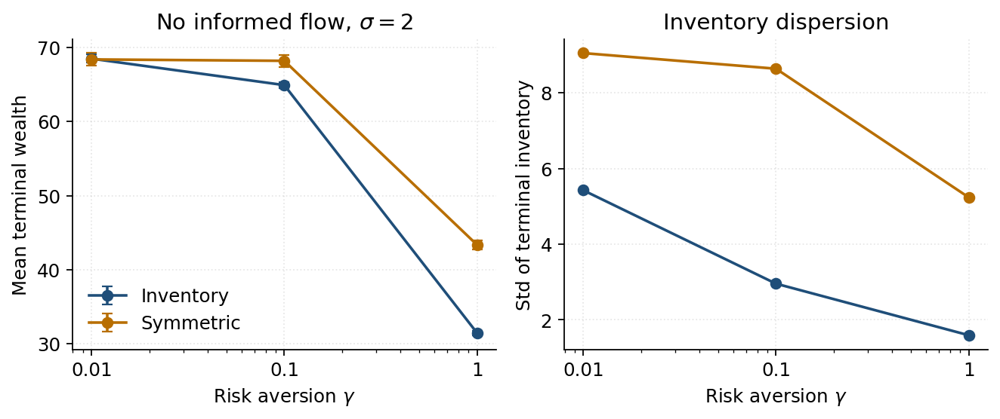
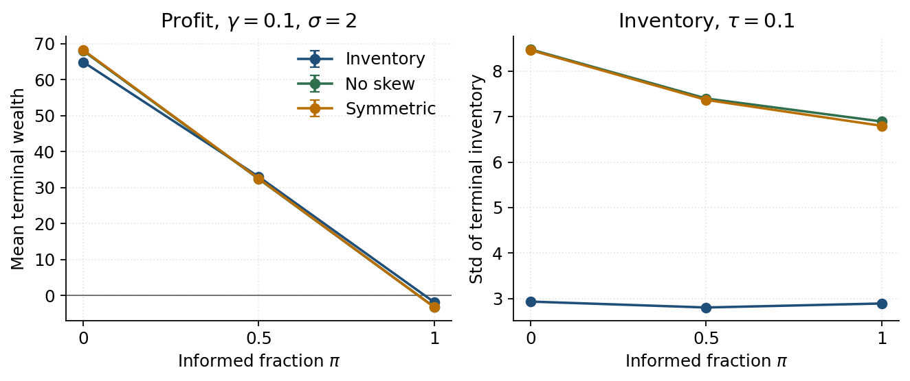
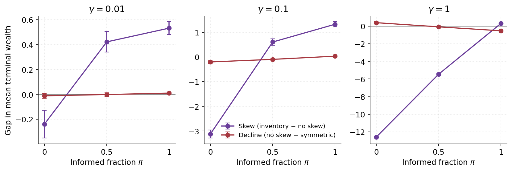
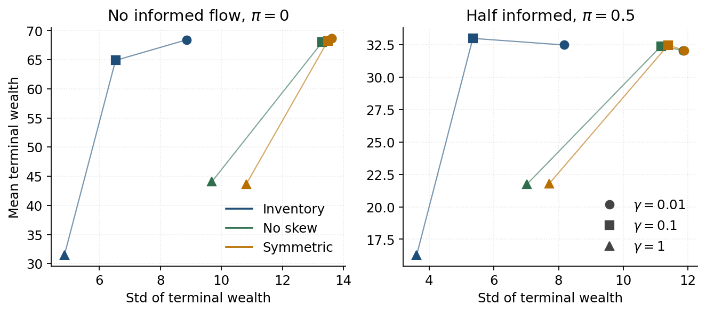
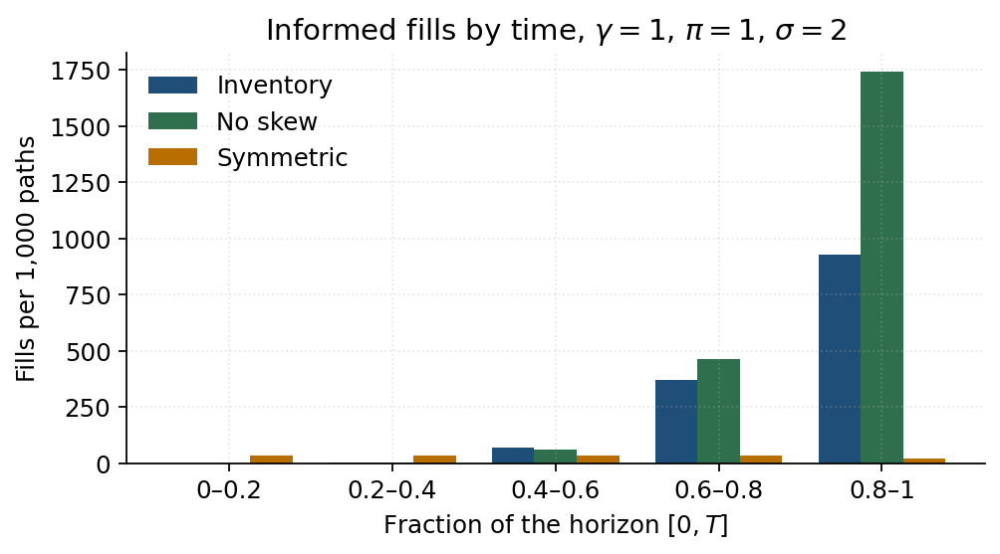
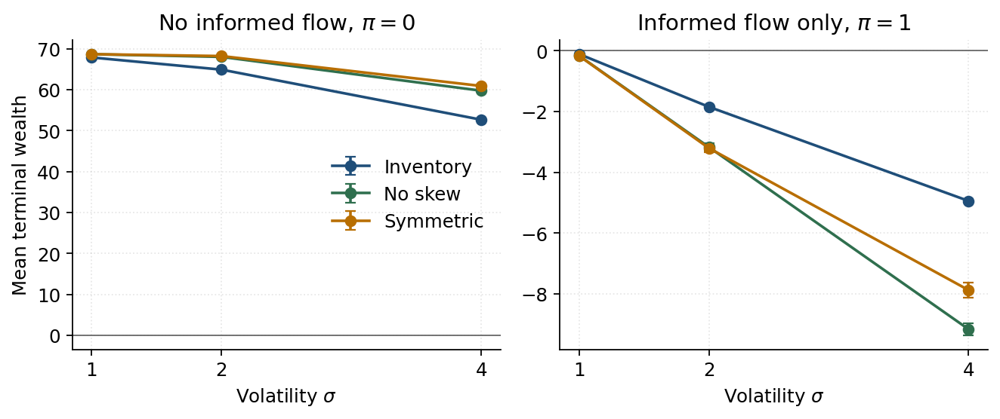
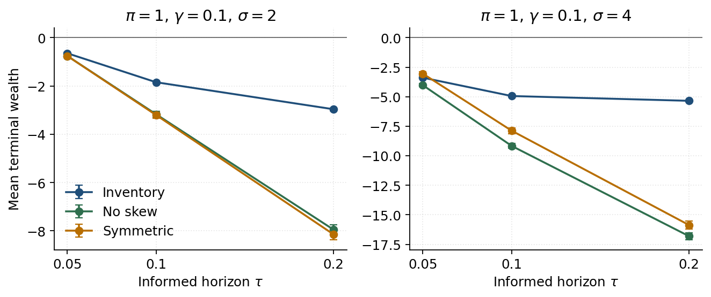

# Avellaneda-Stoikov market making with adverse selection

A discrete-time simulation of Avellaneda and Stoikov (2008). The inventory strategy differs from a mid-centered constant spread in two ways: it skews both quotes with inventory, and its spread declines toward expiry. A third book, with the declining spread and no skew, separates the two. The extension, which the paper does not treat, is a fraction of informed clients who trade only when the quote is on the wrong side of a future mid.

The research question is whether inventory control still improves the mean–risk comparison under this informed-flow filter, and how much of the difference comes from the skew versus the spread schedule. The study first compares the uninformed setting with the published simulations, then varies risk aversion, the informed fraction, volatility, and the informed horizon. These are simulation results under a specified flow model; there is no calibration to market data.

NumPy only. The mid is an arithmetic random walk. Execution probabilities are Bernoulli. The replication uses 1,000 paths, the sample size of the paper. The comparisons use 20,000. Seeds are fixed.

At γ = 0.1 with no informed flow, the skew costs 3.12 ± 0.16 of mean profit and halves P&L volatility. The declining spread costs 0.20 ± 0.06. With informed clients the skew turns into a gain: 0.61 ± 0.13 at π = 0.5 and 1.33 ± 0.10 at π = 1. At γ = 1 and π = 1 the declining spread costs 0.52 ± 0.02, because informed fills pile up where it is tight, and the skew earns 0.32 ± 0.02 of that back. The constant wide spread barely trades.

## Quotes

The original agent maximizes expected terminal exponential utility, E[−exp(−γ(X_T + q_T S_T))], where X is cash and γ > 0 is absolute risk aversion. A lower mean profit can therefore be consistent with the agent's objective if risk falls. This implementation uses the approximate quoting rule in equations (29)–(30), rather than solving the full Hamilton–Jacobi–Bellman equation. See [Avellaneda and Stoikov (2008), sections 3.1–3.2](https://doi.org/10.1080/14697680701381228). The experiments report mean wealth and dispersion; they do not estimate expected exponential utility.

The mid has no drift. Over a step of length dt it moves by ±σ√dt.

A unit inventory q > 0 pulls the reservation price below the mid:

```
r = s − q γ σ² (T − t)
```

Bid and ask are centered on r, not on s. The half-spread on each side is half of

```
spread = γ σ² (T − t) + (2 / γ) ln(1 + γ / k)
```

The first term is the compensation for inventory risk over the time left. It is zero at T. The second is the markup that trades a larger edge per fill against a lower arrival rate λ(δ) = A·exp(−kδ). It does not vanish at expiry. In this approximation the spread does not depend on q. Only the center does.

Fills use the distance to the mid. A long inventory moves both quotes down, so the ask is closer to the mid than the bid and is hit more often. That shift is the skew.

Three books are compared.

| Book | Center | Spread |
|---|---|---|
| Inventory | Reservation price | Declines toward T |
| No skew | Mid | Declines toward T, same as inventory |
| Symmetric | Mid | Constant, the time average of the inventory spread |

Inventory minus no-skew is the effect of the skew. No-skew minus symmetric is the effect of the declining spread. Inventory minus symmetric, the comparison in the paper, is the sum of the two.

Each side fills with probability min(λ(δ) dt, 1), from an independent draw. Both sides can fill in one step. A bid fill buys one share. An ask fill sells one share. Terminal wealth is cash plus leftover inventory marked at the final mid.

This is a Bernoulli approximation to Poisson arrivals, with at most one fill per side per step. It uses λ dt, rather than the Poisson probability 1 − exp(−λ dt) of at least one arrival. The cap changes the arrival rule whenever λ dt exceeds one, which can occur when the inventory skew moves a quote through the mid. The tables use q₀ = 0 and zero initial cash, so terminal wealth equals profit; the simulator's returned wealth would include the initial position's value if q₀ were nonzero.

Parameters of the paper: s₀ = 100, T = 1, σ = 2, dt = 0.005, k = 1.5, A = 140, q₀ = 0, 1,000 paths.

## Match to the paper

Seeds 0 for the paths and 1 for the fills. No informed flow. 1,000 paths. Profit is the mean terminal wealth. The ± is the 95% half-width, 1.96 standard errors.

| γ | Strategy | Spread | Profit | Std(profit) | Std(q_T) | Paper: profit, std, std(q_T) |
|---:|---|---:|---:|---:|---:|---|
| 0.01 | Inventory | 1.35 | 68.5 ± 0.6 | 9.1 | 5.4 | 68.6, 8.7, 5.1 |
| 0.01 | Symmetric | 1.35 | 68.4 ± 0.9 | 13.8 | 9.0 | 68.8, 12.8, 8.7 |
| 0.1 | Inventory | 1.49 | 64.9 ± 0.4 | 6.8 | 3.0 | 65.0, 6.6, 2.9 |
| 0.1 | Symmetric | 1.49 | 68.2 ± 0.8 | 13.3 | 8.6 | 68.4, 12.7, 8.4 |
| 1 | Inventory | 3.03 | 31.5 ± 0.3 | 5.0 | 1.6 | 31.4, 5.0, 1.7 |
| 1 | Symmetric | 3.03 | 43.4 ± 0.6 | 10.4 | 5.2 | 44.0, 11.0, 5.1 |

Means sit on the published figures. Standard deviations differ by a few percent, the same order as the sampling error of a standard deviation on 1,000 paths. The paper estimated its own standard deviations on 1,000 paths as well. The gap is not one-sided: at γ = 1 the symmetric standard deviation here is 10.4 against 11.0 in the paper. At γ = 0.1 the symmetric strategy earns about 3 more and carries twice the P&L volatility and almost three times the inventory dispersion. Raising γ widens the spread, cuts the mean, and pins q down. At γ = 0.01 the two profit intervals overlap on 1,000 paths. On 20,000 the inventory book is 0.25 ± 0.11 behind. The inventory dispersions stay apart: a small reservation shift is still a pull.



## Informed flow

A candidate fill, already drawn from λ(δ) dt, is informed with probability π. The label is drawn from a second generator, so π = 0 does not move the table above. An informed seller hits the bid only if it is strictly above the mid τ ahead. An informed buyer lifts the ask only if it is strictly below that mid. Otherwise the order is cancelled. Uninformed fills stand. The quote is computed before that future mid is read. Past T, the future mid is s_T.

Horizon τ = 0.1 unless a table says otherwise. At σ = 2, one step moves the mid by σ√dt ≈ 0.14, less than the half-spreads of the mid-centered books in the reported grids. Those books would have no informed fills with a one-step horizon. An inventory-skewed quote can be closer to, or through, the mid, so that conclusion does not apply to every inventory state. The code rounds τ / dt to an integer number of steps and clips the look-ahead at T.

σ = 2, 20,000 paths. The three books share paths and the same random draws, so each gap is the mean of a pathwise difference, not a comparison of two separate intervals. Skew is inventory minus no-skew. Decline is no-skew minus symmetric.

The path, candidate-fill, and informed-label seeds are 0, 1, and 2. Every reported ± is an approximate 95% Monte Carlo half-width, 1.96 × std / √N; for a gap, std is computed on the pathwise differences. These intervals measure sampling uncertainty for the fixed model and parameters. They do not cover discretization error or model misspecification, and no adjustment is made for the multiple comparisons across the grids. The skew and decline gaps add exactly along this comparison sequence; their values need not be unchanged under a different spread benchmark.

| γ | π | Inventory | No skew | Symmetric | Skew | Decline |
|---:|---:|---:|---:|---:|---:|---:|
| 0.01 | 0 | 68.41 ± 0.12 | 68.65 ± 0.19 | 68.66 ± 0.19 | −0.24 ± 0.11 | −0.01 ± 0.02 |
| 0.01 | 0.5 | 32.50 ± 0.11 | 32.07 ± 0.16 | 32.07 ± 0.16 | 0.42 ± 0.08 | 0.00 ± 0.01 |
| 0.01 | 1 | −3.93 ± 0.11 | −4.46 ± 0.14 | −4.47 ± 0.14 | 0.53 ± 0.05 | 0.01 ± 0.01 |
| 0.1 | 0 | 64.88 ± 0.09 | 68.00 ± 0.18 | 68.20 ± 0.19 | −3.12 ± 0.16 | −0.20 ± 0.06 |
| 0.1 | 0.5 | 33.00 ± 0.07 | 32.40 ± 0.15 | 32.49 ± 0.16 | 0.61 ± 0.13 | −0.10 ± 0.04 |
| 0.1 | 1 | −1.85 ± 0.04 | −3.17 ± 0.12 | −3.20 ± 0.13 | 1.33 ± 0.10 | 0.03 ± 0.02 |
| 1 | 0 | 31.47 ± 0.07 | 44.06 ± 0.13 | 43.66 ± 0.15 | −12.59 ± 0.10 | 0.40 ± 0.11 |
| 1 | 0.5 | 16.28 ± 0.05 | 21.73 ± 0.10 | 21.81 ± 0.11 | −5.46 ± 0.07 | −0.07 ± 0.08 |
| 1 | 1 | −0.24 ± 0.01 | −0.56 ± 0.02 | −0.03 ± 0.01 | 0.32 ± 0.02 | −0.52 ± 0.02 |



The three means are close on that scale. The gaps are plotted on their own below, one panel per γ.



With no informed flow the skew is the cost: −0.24 ± 0.11, −3.12 ± 0.16, and −12.59 ± 0.10 as γ rises. It is also what holds inventory: at γ = 0.1 the standard deviation of q_T is 2.93 for the inventory book and 8.48 for the no-skew book, against 8.46 for the symmetric one. The decline is small. At γ = 1 it is a gain of 0.40 ± 0.11: the no-skew book fills 40.9 times per path against 28.8 for the symmetric book, at a smaller edge per fill, and comes out ahead.

From π = 0 to π = 0.5 at γ = 0.1, inventory fills fall by about 44%, from 97.0 to 54.6 per path, and profit by about half. The surviving trades are worse, not only fewer. At π = 0 the symmetric book earns 0.75 per fill, its half-spread. At π = 0.5 that edge is 0.63. The inventory book was already earning less per fill (0.67), because it leans a quote toward the mid to get out of a position, and it gives up less of that edge (down to 0.60).

At π = 0.5 the skew changes sign at γ = 0.01 and γ = 0.1. At γ = 0.1 the inventory book leads the no-skew book by 0.61 ± 0.13 and the symmetric book by 0.51 ± 0.14. At γ = 1 the skew still costs 5.46 ± 0.07: the spread is 3.03, uninformed clients are still paying it, and a quote leaned in to shed inventory gives that edge away. A wider spread does not raise the inventory mean either: 33.00 ± 0.07 at γ = 0.1, then 16.28 ± 0.05 at γ = 1.

The mean is half of the comparison. The figure below plots it against the standard deviation of terminal wealth, for each book and each γ.



With no informed flow the skew trades mean for risk. At γ = 0.1 it gives up 3.12 of mean and cuts the standard deviation from 13.30 to 6.53. At π = 0.5 and γ = 0.1 there is no trade: the inventory book has the higher mean, 33.00 against 32.40, and the lower standard deviation, 5.35 against 11.17. At γ = 1 the trade is back: 16.28 at 3.61 for the inventory book, 21.73 at 7.02 for the no-skew book.

At π = 1 every remaining fill is toxic by construction. The skew is a gain at all three risk aversions. Inventory profit is still negative. Raising γ from 0.01 to 1 cuts inventory fills from 12.49 to 1.37 per path and shrinks the loss from −3.93 ± 0.11 to −0.24 ± 0.01.

At γ = 1 and π = 1 the two effects pull apart. The symmetric book finishes at −0.03 ± 0.01, with 0.16 fills per path. The no-skew book loses 0.56 ± 0.02 on 2.27 fills. The inventory book loses 0.24 ± 0.01 on 1.37 fills. The declining spread costs 0.52 ± 0.02. The skew earns back 0.32 ± 0.02. The inventory book ends 0.21 ± 0.01 behind the symmetric book.

The spread falls from 4.63 in the first fifth of [0, T] to 1.43 in the last. The symmetric book stays at 3.03. Fills per 1,000 paths, by fifth:

| Fifth | Spread | Inventory | No skew | Symmetric |
|---|---:|---:|---:|---:|
| 0–0.2 | 4.63 | 0.2 | 0.2 | 35.7 |
| 0.2–0.4 | 3.83 | 3.7 | 2.9 | 32.8 |
| 0.4–0.6 | 3.02 | 69.9 | 63.0 | 36.4 |
| 0.6–0.8 | 2.22 | 371.0 | 464.4 | 32.6 |
| 0.8–1 | 1.43 | 926.0 | 1739.2 | 21.6 |

Two thirds of the inventory fills and about three quarters of the no-skew fills fall in the last fifth, where the half-spread approaches σ√τ = 0.63 and then goes under it. The symmetric fills stay flat. The pile-up comes with the declining spread, with or without the skew. The skew cuts the fills of that last fifth from 1,739 to 926.



## Volatility

γ = 0.1, τ = 0.1, 20,000 paths. Paths are redrawn at each σ with seed 0, so the signs of the shocks match and only the size changes. The spread goes from 1.34 at σ = 1 to 2.09 at σ = 4. Over the informed horizon the mid moves by σ√τ: 0.32, then 0.63, then 1.26. At σ = 4 that move is larger than the half-spread.

| σ | π | Inventory | No skew | Symmetric | Skew | Decline |
|---:|---:|---:|---:|---:|---:|---:|
| 1 | 0 | 67.86 ± 0.09 | 68.65 ± 0.12 | 68.66 ± 0.12 | −0.79 ± 0.08 | −0.02 ± 0.02 |
| 1 | 0.5 | 33.92 ± 0.07 | 34.23 ± 0.09 | 34.24 ± 0.09 | −0.31 ± 0.05 | −0.01 ± 0.01 |
| 1 | 1 | −0.11 ± 0.01 | −0.16 ± 0.02 | −0.17 ± 0.02 | 0.05 ± 0.01 | 0.01 ± 0.00 |
| 2 | 0 | 64.88 ± 0.09 | 68.00 ± 0.18 | 68.20 ± 0.19 | −3.12 ± 0.16 | −0.20 ± 0.06 |
| 2 | 0.5 | 33.00 ± 0.07 | 32.40 ± 0.15 | 32.49 ± 0.16 | 0.61 ± 0.13 | −0.10 ± 0.04 |
| 2 | 1 | −1.85 ± 0.04 | −3.17 ± 0.12 | −3.20 ± 0.13 | 1.33 ± 0.10 | 0.03 ± 0.02 |
| 4 | 0 | 52.65 ± 0.09 | 59.74 ± 0.28 | 60.89 ± 0.29 | −7.08 ± 0.26 | −1.15 ± 0.16 |
| 4 | 0.5 | 27.64 ± 0.08 | 25.26 ± 0.23 | 26.48 ± 0.26 | 2.38 ± 0.21 | −1.22 ± 0.14 |
| 4 | 1 | −4.94 ± 0.05 | −9.16 ± 0.20 | −7.88 ± 0.25 | 4.22 ± 0.17 | −1.29 ± 0.14 |



Without informed flow, a higher σ lowers the inventory mean (67.86, 64.88, 52.65) and tightens inventory (standard deviation of q_T: 4.16, 2.93, 2.07). The reservation shift scales with σ², so the book leans harder against a position while the mid is more violent. The cost of the skew grows with it: −0.79 ± 0.08, −3.12 ± 0.16, −7.08 ± 0.26.

With only informed clients the inventory mean falls as well, from −0.11 ± 0.01 at σ = 1 to −1.85 ± 0.04 at σ = 2 and −4.94 ± 0.05 at σ = 4. Over the horizon τ, the mid moves like σ, while the half-spread grows more slowly, so more informed orders find the quote on the wrong side of the future mid. The skew is a gain at each volatility, and the gain grows: 0.05 ± 0.01, 1.33 ± 0.10, 4.22 ± 0.17.

At π = 0.5 the sign of the skew depends on σ: −0.31 ± 0.05 at σ = 1, 0.61 ± 0.13 at σ = 2, 2.38 ± 0.21 at σ = 4.

The decline is near zero at σ = 1 and σ = 2. At σ = 4 it costs about 1.2 at every π. The inventory-risk term γσ²(T − t) starts at 0.1 when σ = 1 and at 1.6 when σ = 4, so the spread at σ = 4 moves much more through the horizon.

## Horizon of the informed trader

π = 1, γ = 0.1, 20,000 paths. Same seeds as the other grids.

| σ | τ | Inventory | No skew | Symmetric | Skew | Decline |
|---:|---:|---:|---:|---:|---:|---:|
| 2 | 0.05 | −0.65 ± 0.02 | −0.76 ± 0.06 | −0.76 ± 0.06 | 0.11 ± 0.05 | 0.00 ± 0.01 |
| 2 | 0.10 | −1.85 ± 0.04 | −3.17 ± 0.12 | −3.20 ± 0.13 | 1.33 ± 0.10 | 0.03 ± 0.02 |
| 2 | 0.20 | −2.96 ± 0.05 | −7.95 ± 0.20 | −8.15 ± 0.21 | 4.99 ± 0.17 | 0.20 ± 0.03 |
| 4 | 0.05 | −3.39 ± 0.04 | −4.03 ± 0.13 | −3.05 ± 0.17 | 0.64 ± 0.11 | −0.98 ± 0.12 |
| 4 | 0.10 | −4.94 ± 0.05 | −9.16 ± 0.20 | −7.88 ± 0.25 | 4.22 ± 0.17 | −1.29 ± 0.14 |
| 4 | 0.20 | −5.35 ± 0.06 | −16.82 ± 0.28 | −15.87 ± 0.35 | 11.47 ± 0.24 | −0.94 ± 0.16 |

Lengthening τ deepens the loss of all three books. The skew is a gain in all six cells, and it grows with the horizon. At σ = 2 the decline is small, so the inventory lead over the symmetric book is the skew. At σ = 4 the decline costs about 1 at every horizon. At τ = 0.05 that cost is larger than the skew: the skew is +0.64 ± 0.11, the decline is −0.98 ± 0.12, and the inventory book ends 0.34 ± 0.16 behind the symmetric book. A shorter horizon does not remove the loss: at τ = 0.05 all three means are still negative. The scale σ√τ is a guide, not a hard threshold, because the move is random.



## Limits

The quotes do not depend on π. The spread is the Avellaneda-Stoikov spread, built for uninformed Poisson flow. These runs measure the cost of leaving that rule unchanged once some clients are informed. They are not the best response to π. A spread that widens with the informed fraction, in the spirit of Glosten and Milgrom, is the natural next quote.

The informed trader is stylized. He cancels when the quote is not through the future mid, rather than hitting a side whenever he has a signal. After T, that future mid is frozen at s_T.

The quoted intervals do not establish convergence as dt tends to zero. The Bernoulli rule, its probability cap, and the discrete price increments can affect executions. Varying dt while holding the physical horizons fixed is a remaining robustness check.

Each fill is one unit. There are no fees and no other market maker. Inventory is unbounded. A quote is also revised with no lag: the next step replaces it before anyone can hit a stale price. Lehalle and Mounjid (2017) show that this lag is a cost of its own. An informed flow can lift a limit order in the time it takes to cancel it.

The mid is an input. A quote never waits in a queue, and no trade moves the price. The two gaps above provide a reference for a future experiment posting these same quotes as limit orders in a book, where the mid is the book's own mid (Cont, Stoikov and Talreja, 2010). Whether the signs of the gaps survive queueing, competing liquidity, and endogenous price changes remains to be tested. Even here, an informed fraction of π = 0.5 does not make the skew profitable at every γ and σ. Here π is the informed-label probability for candidate fills before filtering, rather than the informed share of executed trades. A share of incoming order flow in a book would be another quantity. The package exposes `quotes`, so that book can post them without copying the formula.

## Layout

| Path | Role |
|---|---|
| `src/avellaneda_stoikov/price.py` | Arithmetic mid paths. |
| `src/avellaneda_stoikov/strategies.py` | Reservation price, optimal spread, and the same spread centered on the mid. |
| `src/avellaneda_stoikov/flow.py` | Fill draws, cash and inventory, informed filter. |
| `src/avellaneda_stoikov/simulator.py` | Inventory, no-skew, and symmetric books on a shared set of paths. |
| `experiments/grid_gamma_pi.py` | The paper setting on 1,000 paths, then γ ∈ {0.01, 0.1, 1}, π ∈ {0, 0.5, 1} on 20,000. |
| `experiments/grid_sigma.py` | σ ∈ {1, 2, 4}, same π grid, γ = 0.1. |
| `experiments/grid_tau.py` | τ ∈ {0.05, 0.1, 0.2} at π = 1, for σ = 2 and σ = 4. |
| `experiments/fills_by_time.py` | Informed fills by fifth of [0, T] at γ = 1, π = 1. |
| `experiments/make_figures.py` | The seven figures in this note. |
| `tests/` | Pytest checks for the random walk, fill rates, quotes, and accounting. |

## Run

```bash
pip install -e ".[dev]"
pytest
python3 experiments/grid_gamma_pi.py
python3 experiments/grid_sigma.py
python3 experiments/grid_tau.py
python3 experiments/fills_by_time.py
python3 experiments/make_figures.py
```

`pytest` checks that terminal variance is near σ²T, that fill frequencies track λ(δ) dt, that the no-skew book posts the inventory spread, and that a fixed seed reproduces the inventory mean at γ = 0.1 with no informed flow. Each grid prints a 95% half-width on every mean profit, then a `gaps` line with the pathwise skew, decline, and total. Seeds are fixed, so the tables repeat.

## Reference

Avellaneda, M. and Stoikov, S. (2008). High-frequency trading in a limit order book. *Quantitative Finance* 8(3), 217–224. [doi:10.1080/14697680701381228](https://doi.org/10.1080/14697680701381228).

Cont, R., Stoikov, S. and Talreja, R. (2010). A stochastic model for order book dynamics. *Operations Research* 58(3), 549–563.

Lehalle, C.-A. and Mounjid, O. (2017). Limit order strategic placement with adverse selection risk and the role of latency. *Market Microstructure and Liquidity* 3(1), 1750009.
