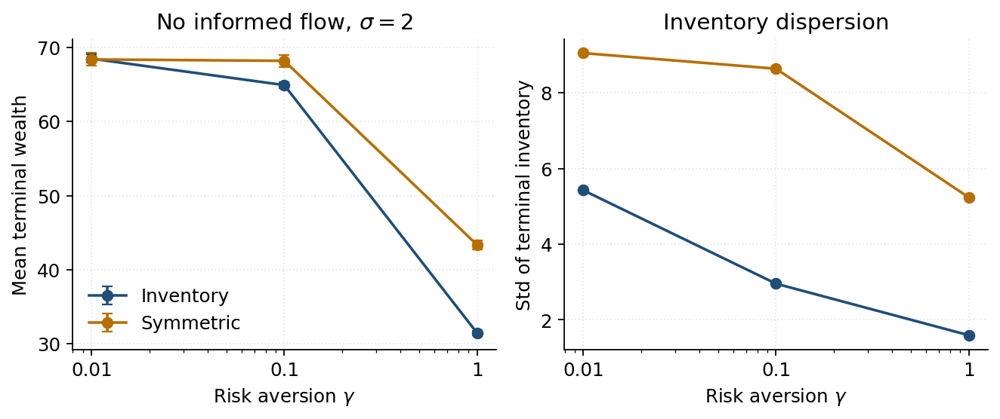
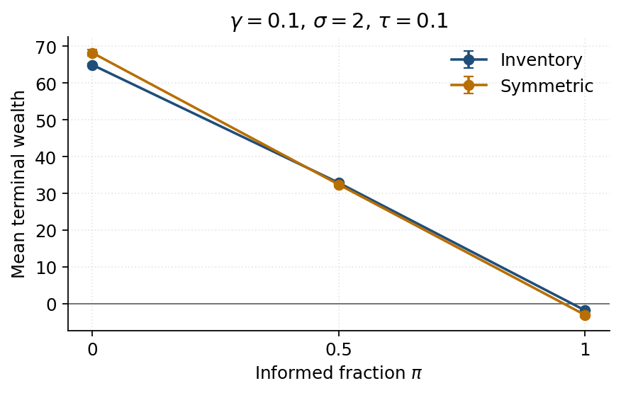
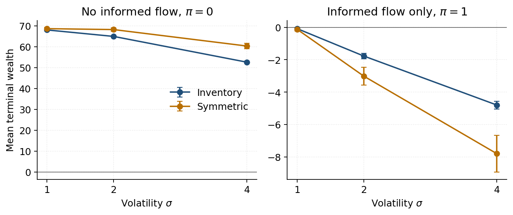

# Avellaneda-Stoikov market making with adverse selection

A discrete-time simulation of Avellaneda and Stoikov (2008), and a controlled comparison with a market maker who posts the same average spread but does not skew quotes for inventory. The extension, which the paper does not treat, is a fraction of informed clients who trade only when the quote is on the wrong side of a future mid.

NumPy only. The mid is an arithmetic random walk. Execution probabilities are Bernoulli. One thousand paths, fixed seeds.

## Quotes

The mid has no drift. Over a step of length \(dt\) it moves by \(\pm \sigma \sqrt{dt}\).

A unit inventory \(q > 0\) pulls the reservation price below the mid:

\[
r = s - q \, \gamma \, \sigma^2 (T - t).
\]

Bid and ask are centered on \(r\), not on \(s\). The half-spread on each side is half of

\[
\delta_a + \delta_b = \gamma \, \sigma^2 (T - t) + \frac{2}{\gamma} \ln\left(1 + \frac{\gamma}{k}\right).
\]

The first term is the compensation for inventory risk over the time left. It is zero at \(T\). The second is the markup that trades a larger edge per fill against a lower arrival rate \(\lambda(\delta) = A e^{-k\delta}\). It does not vanish at expiry. In this approximation the spread does not depend on \(q\). Only the center does.

Fills use the distance to the mid. A long inventory moves both quotes down, so the ask is closer to the mid than the bid and is hit more often. That is the inventory control. The symmetric benchmark posts the inventory strategy's average spread, constant through time, and centers it on the mid. Same width, no skew.

Each side fills with probability \(\min(\lambda(\delta)\, dt,\, 1)\), from an independent draw. Both sides can fill in one step. A bid fill buys one share. An ask fill sells one share. Terminal wealth is cash plus leftover inventory marked at the final mid.

Parameters of the paper: \(s_0 = 100\), \(T = 1\), \(\sigma = 2\), \(dt = 0.005\), \(k = 1.5\), \(A = 140\), \(q_0 = 0\), 1,000 paths.

## Match to the paper

Seeds 0 for the paths and 1 for the fills. No informed flow. Profit is the mean terminal wealth. The interval is not shown here; the sampling error on the mean is about 0.2 to 0.4.

| \(\gamma\) | Strategy | Spread | Profit | Std(profit) | Std(\(q_T\)) | Paper: profit, std, std(\(q_T\)) |
|---:|---|---:|---:|---:|---:|---|
| 0.01 | Inventory | 1.35 | 68.5 | 9.1 | 5.4 | 68.6, 8.7, 5.1 |
| 0.01 | Symmetric | 1.35 | 68.4 | 13.8 | 9.0 | 68.8, 12.8, 8.7 |
| 0.1 | Inventory | 1.49 | 64.9 | 6.8 | 3.0 | 65.0, 6.6, 2.9 |
| 0.1 | Symmetric | 1.49 | 68.2 | 13.3 | 8.6 | 68.4, 12.7, 8.4 |
| 1 | Inventory | 3.03 | 31.5 | 5.0 | 1.6 | 31.4, 5.0, 1.7 |
| 1 | Symmetric | 3.03 | 43.4 | 10.4 | 5.2 | 44.0, 11.0, 5.1 |

Means sit on the published figures. Standard deviations are within a few percent. At \(\gamma = 0.1\) the symmetric strategy earns about 3 more and carries twice the P&L volatility and almost three times the inventory dispersion. Raising \(\gamma\) widens the spread, cuts the mean, and pins \(q\) down. As \(\gamma \to 0\) the two means meet. The inventory dispersions do not: a small reservation shift is still a pull.



## Informed flow

A candidate fill, already drawn from \(\lambda(\delta)\, dt\), is informed with probability \(\pi\). The label is drawn from a second generator, so \(\pi = 0\) does not move the table above. An informed seller hits the bid only if it is strictly above the mid \(\tau\) ahead. An informed buyer lifts the ask only if it is strictly below that mid. Otherwise the order is cancelled. Uninformed fills stand. The quote is computed before that future mid is read. Past \(T\), the future mid is \(s_T\).

Horizon \(\tau = 0.1\). One step moves the mid by \(\sigma\sqrt{dt} \approx 0.14\), less than a half-spread of about 0.75, so a one-step horizon would never trigger an informed trade.

At \(\gamma = 0.1\), \(\sigma = 2\):

| \(\pi\) | Strategy | Profit | Std(\(q_T\)) | Fills per path |
|---:|---|---:|---:|---:|
| 0 | Inventory | 64.9 ± 0.4 | 3.0 | 97.2 |
| 0 | Symmetric | 68.2 ± 0.8 | 8.6 | 91.6 |
| 0.5 | Inventory | 32.9 ± 0.3 | 2.7 | 54.4 |
| 0.5 | Symmetric | 32.4 ± 0.7 | 7.5 | 51.2 |
| 1 | Inventory | −1.8 ± 0.2 | 2.9 | 8.4 |
| 1 | Symmetric | −3.0 ± 0.6 | 6.7 | 11.4 |



From \(\pi = 0\) to \(\pi = 0.5\), fills fall by about 44% and profit by about half. The surviving trades are worse, not only fewer. At \(\pi = 0\) the symmetric book earns 0.75 per fill, its half-spread. At \(\pi = 0.5\) that edge is 0.63. The inventory strategy was already earning less per fill (0.67), because it leans a quote toward the mid to get out of a position, and it gives up less of that edge (down to 0.60).

At \(\pi = 1\) every remaining fill is toxic by construction, and the mean goes negative. Widening to \(\gamma = 1\) makes the informed condition harder: inventory fills per path fall from 12.7 to 1.3, and the loss shrinks from −3.8 toward zero. The same widening at \(\pi = 0.5\) does not help the mean. Inventory profit goes from 32.9 ± 0.3 at \(\gamma = 0.1\) to 16.2 ± 0.2 at \(\gamma = 1\). The spread cost dominates while uninformed flow is still there.

## Volatility

\(\gamma = 0.1\). Paths are redrawn at each \(\sigma\) with seed 0, so the signs of the shocks match and only the size changes. The spread goes from 1.34 at \(\sigma = 1\) to 2.09 at \(\sigma = 4\). Over the informed horizon the mid moves by \(\sigma\sqrt{\tau}\): 0.32, then 0.63, then 1.26. At \(\sigma = 4\) that move is larger than the half-spread.



Without informed flow, a higher \(\sigma\) lowers the mean (inventory profit 68.0, 64.9, 52.6) and tightens inventory (standard deviation of \(q_T\): 4.3, 3.0, 2.1). The reservation shift scales with \(\sigma^2\), so the book leans harder against a position while the mid is more violent. With only informed clients the mean goes the other way: about −0.1 at \(\sigma = 1\), −1.8 at \(\sigma = 2\), and −4.8 ± 0.2 at \(\sigma = 4\) for the inventory strategy. The symmetric book, which does not shade, loses more: −7.8 ± 1.1 at \(\sigma = 4\).

The spread posted around a reservation price buys a smaller inventory and, once the flow is informed, a smaller loss. It does not buy a higher mean while uninformed clients are still paying the spread.

## Layout

| Path | Role |
|---|---|
| `src/price.py` | Arithmetic mid paths. |
| `src/strategies.py` | Reservation price and optimal spread. |
| `src/flow.py` | Fill draws, cash and inventory, informed filter. |
| `src/simulator.py` | Inventory strategy and symmetric benchmark on a shared set of paths. |
| `experiments/grid_gamma_pi.py` | \(\gamma \in \{0.01, 0.1, 1\}\), \(\pi \in \{0, 0.5, 1\}\), \(\sigma = 2\). |
| `experiments/grid_sigma.py` | \(\sigma \in \{1, 2, 4\}\), same \(\pi\) grid, \(\gamma = 0.1\). |
| `experiments/make_figures.py` | The three figures in this note. |
| `tests/` | Checks for the random-walk variance, fill frequencies, quote formulas, and accounting signs. |

## Run

```bash
pip install -r requirements.txt
PYTHONPATH=. python3 tests/test_price.py
PYTHONPATH=. python3 tests/test_flow.py
PYTHONPATH=. python3 tests/test_strategies.py
PYTHONPATH=. python3 tests/test_simulator.py
PYTHONPATH=. python3 experiments/grid_gamma_pi.py
PYTHONPATH=. python3 experiments/grid_sigma.py
PYTHONPATH=. python3 experiments/make_figures.py
```

`test_price.py` should print shape `(1000, 201)`, a terminal mean near 100, and a terminal variance near 4, which is \(\sigma^2 T\). The grids print a 95% half-width on every mean profit. Seeds are fixed, so the tables repeat.

## Reference

Avellaneda, M. and Stoikov, S. (2008). High-frequency trading in a limit order book. *Quantitative Finance* 8(3), 217–224.
